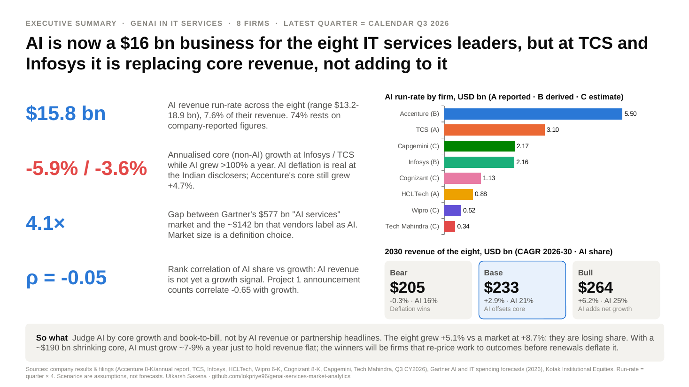
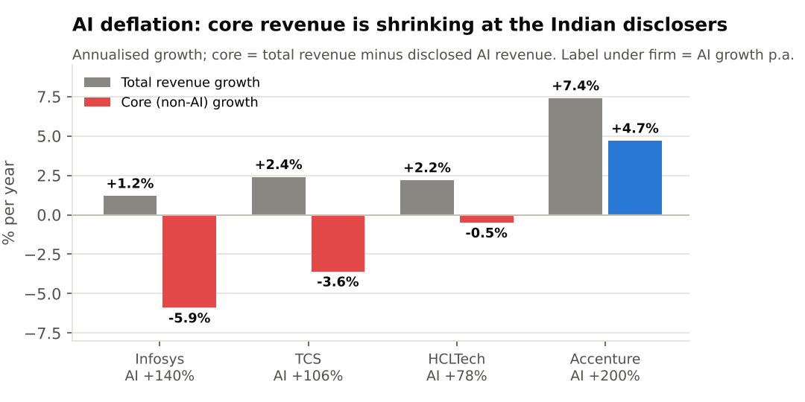
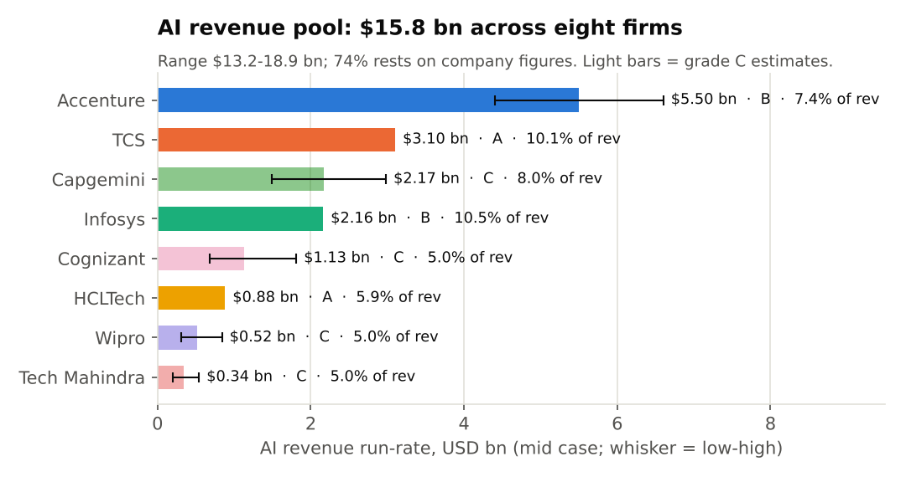

# GenAI Services Market Analytics & Competitive Dashboard

**Market analytics and competitive dashboard: analysing market size, company revenue, share, growth and competitive positioning on public data (Python, SQL, Excel, Power BI).**

**Live dashboard:** https://lokpriye96.github.io/genai-services-market-analytics/

**Part of a three-project series** on GenAI in IT services, following the same eight firms:

| Project | Question | Link |
|---|---|---|
| 1. AI-Powered CI Tracker | What do firms announce? | [Dashboard](https://lokpriye96.github.io/ai-ci-tracker/) · [Repo](https://github.com/lokpriye96/ai-ci-tracker) |
| **2. Market Analytics & Competitive Dashboard** (this repo) | What shows up as revenue? | [Dashboard](https://lokpriye96.github.io/genai-services-market-analytics/) |
| 3. AI-Assisted Consulting Report | What should a leader do? | [Report](https://lokpriye96.github.io/ai-consulting-report-genai-services/) · [Repo](https://github.com/lokpriye96/ai-consulting-report-genai-services) |



---

## The business question

> **How big is the GenAI services revenue pool, who is actually monetising it, and is AI growing IT services firms or eating into their core business?**

Project 1 tracked *what* eight IT services leaders announced about GenAI: partnerships, acquisitions and deals. This project follows the money. It asks whether those announcements show up as revenue, and whether that revenue is net-new or simply replaces older work at lower prices ("AI deflation").

**The eight firms:** Accenture, TCS, Infosys, HCLTech, Cognizant, Capgemini, Wipro, Tech Mahindra.

**Objectives**

1. **Size the market three ways:** analyst top-down, management view, and bottom-up from company disclosures. Explain why the three disagree.
2. **Build the AI revenue pool firm by firm,** grading every figure: A = reported, B = derived, C = estimate with a range.
3. **Test whether AI is net-additive,** by splitting revenue into AI and core (non-AI) revenue over time.
4. **Position the firms** on AI intensity, growth, productivity and Project 1 announcement momentum.
5. **Project 2027–2030 under Bear / Base / Bull scenarios,** with explicit levers.

## Key findings

| # | Finding | Evidence |
|---|---|---|
| 1 | **AI is a ~$15.8 bn business for the eight** (range $13.2–18.9 bn), 7.6% of their $207.8 bn revenue run-rate. 74% of that figure rests on company-reported numbers. | TCS $3.1 bn annualised (10.1% of revenue); Infosys 10.5% of revenue; HCLTech $0.9 bn |
| 2 | **At the Indian-heritage disclosers, AI is replacing core revenue, not adding to it.** Core (non-AI) revenue shrank −5.9%/yr at Infosys, −3.6%/yr at TCS and −0.5%/yr at HCLTech, while AI grew 78–140% a year. Accenture's core still grew +4.7% (FY25). | `sql/03_core_vs_ai.sql` |
| 3 | **"AI market size" is a definition choice.** Gartner's $576.5 bn AI services market is ~4.1× the ~$142 bn that vendors actually label as AI. The eight firms hold only 2.7% of Gartner's figure. | `outputs/analysis/market_sizing.csv` |
| 4 | **More AI revenue is not (yet) more growth.** The most AI-intensive firms (Infosys, TCS) are among the slowest growers. Spearman ρ = −0.05 across all eight (p≈0.9); the four disclosers cannot be tested for significance. | Positioning chart |
| 5 | **Growth trails the market forecast.** The eight grew +5.1% YoY in USD against Gartner's +8.7% 2026 IT services forecast. The periods differ (fiscal quarters vs a calendar-year forecast), and Capgemini's growth includes WNS. | `sql/01_market_share.sql` |
| 6 | **Announcements do not predict money.** Project 1 event counts correlate −0.57 with growth (n=8, p≈0.14, not significant). The most active announcers include HCLTech, TCS and Wipro, all growing under 3%. | `sql/05_momentum_vs_money.sql` |
| 7 | **Little sign yet of non-linear growth.** The median gap between revenue growth and headcount growth is only +1.4pp. Tech Mahindra is the exception (+6.9% revenue per employee). | `sql/04_productivity.sql` |

**So what:** judge AI by core growth and book-to-bill, not by the AI revenue line or partnership headlines. With a ~$190 bn core that is shrinking, AI must grow ~7–9% a year just to hold total revenue flat.

<p float="left">
  
  
</p>

## Market sizing: three lenses

| Lens | Measure | USD bn | Reading |
|---|---|---|---|
| A. Analyst top-down | Gartner AI services spending, 2026 | 576.5 | Broadest definition: includes AI embedded in ordinary projects |
| B. Management view | Infosys: "AI services market" | 300–400 | Management view (Investor AI Day, Feb-2026); definition not given |
| C. Bottom-up | Eight firms' AI revenue run-rate | 15.8 (13.2–18.9) | Disclosed, derived and estimated, graded A/B/C |
| C. Bottom-up | Implied vendor-labelled market | 142 (119–170) | Eight-firm pool ÷ their 11.1% share of Gartner's $1.87 tn IT services market |

**Assumptions for the five firms without a clean disclosure** (full rationale in `data/raw/ai_estimation_assumptions.csv`):

| Firm | Method | Low / mid / high |
|---|---|---|
| Accenture (B) | Last quarterly AI revenue found (~$1.1 bn, Q1 FY26) × 4 × uplift (×1.00 low, ×1.25 mid, ×1.50 high) | $4.4 / 5.5 / 6.6 bn |
| Capgemini (C) | Share of bookings that is AI (>11%) × conversion to revenue | 5.5 / 8 / 11% of revenue |
| Cognizant, Wipro, Tech Mahindra (C) | Peer benchmark: AI share at peers' first disclosure | 3 / 5 / 8% of revenue |

## Scenarios, 2027–2030

| Scenario | Story | 2030 revenue | CAGR 2026–30 | AI share 2030 |
|---|---|---|---|---|
| **Bear** | Deflation wins: core falls up to −3.5%/yr; AI growth fades to 12% | $205 bn | −0.3% | 16% |
| **Base** | AI offsets core: core drifts to −1.5%/yr; AI growth halves to 20–35% | $233 bn | +2.9% | 21% |
| **Bull** | AI adds net growth: core holds ~+0.5–1.5%; AI grows 28–65%/yr | $264 bn | +6.2% | 25% |

- **Levers:** AI growth and core growth per year.
- **Calibration:** 2025–26 disclosures (AI +78–140%/yr; core −0.5 to −5.9%/yr) and published deflation estimates (Kotak 3–3.5%/yr; HCLTech 2–3%).
- **Not a forecast.** Change the levers in the Excel model (`Scenarios` sheet) or in `src/analysis.py`.

## Hypotheses tested

| # | Hypothesis | Result |
|---|---|---|
| H1 | GenAI is now material revenue, not a pilot-stage side line | **Supported** |
| H2 | AI growth is arriving alongside a shrinking core business (AI deflation) | **Supported for TCS and Infosys**: an upper bound, as TCS core rests on two data points; weaker for HCLTech; not seen at Accenture |
| H3 | The firms with the most AI revenue are not the ones growing fastest | **Supported, directionally**: AI share shows no positive link to growth (n=8, not statistically significant) |
| H4 | AI has decoupled revenue from headcount | **Not yet visible**: headcount still moves broadly with revenue; Tech Mahindra is the exception |
| H5 | Announcement momentum (Project 1) predicts AI monetisation | **Not supported**: announcement counts do not predict AI revenue or growth (n=8, not significant) |

The test and evidence for each are in `outputs/analysis/hypotheses.csv` and on the dashboard.

## Deliverables

| Deliverable | Where |
|---|---|
| Interactive web dashboard (filters for AI case and scenario, tooltips, table views, dark mode) | `docs/index.html` → GitHub Pages |
| Excel model: inputs, 300+ live formulas, Low/Mid/High and scenario dropdowns, checks sheet, Project 1 COUNTIFS join | `outputs/GenAI_Services_Market_Model.xlsx` |
| Power BI star schema and step-by-step build guide with DAX and expected values | `powerbi/`, `guides/POWERBI_GUIDE.md` |
| One-slide executive summary | `outputs/Executive_Summary.pptx` / `.pdf` |
| SQL analysis (SQLite): 7 query files and 22 data-quality checks | `sql/`, results in `outputs/sql_results/` |
| Data dictionary · verification checklist | `guides/` |

## Method

```
data/raw/*.csv  ──clean.py──▶  data/processed  ──build_db.py──▶  db/genai_services.db ──▶ sql/01–07 ──▶ outputs/sql_results
 (hand-transcribed,                                                                 │
  every row → source_id)                                       analysis.py ◀─────────┘ ──▶ sizing, hypotheses, scenarios
                                                                    │
             build_excel.py · charts.py · build_dashboard.py · export_powerbi.py · exec_slide.js
```

- **Common basis.** Latest quarter = calendar Q3 2026; run-rate = quarter × 4; all figures in USD. Capgemini is converted from EUR at the rate Reuters used.
- **Evidence grades.**
  - **A:** company-reported (TCS, HCLTech AI revenue).
  - **B:** derived from a company figure (Infosys share × revenue; Accenture).
  - **C:** estimate with a low/mid/high range (Capgemini, Cognizant, Wipro, Tech Mahindra).
- **Python** (pandas) cleans the inputs, derives values, builds the AI pool and runs the scenarios; Spearman rank correlations are computed in pandas.
- **SQL** does the analysis itself. Examples: share and growth, AI-pool ranges, core-vs-AI growth annualised with `POWER()`, ranking with `RANK()`, the join to Project 1, and a data-quality suite that stops the build if any check fails.
- **Join to Project 1.** The 80 verified CI events from [ai-ci-tracker](https://github.com/lokpriye96/ai-ci-tracker) are loaded as a table and joined by company (H5).

**SQL highlight.** Splitting AI and core revenue and annualising each (from `sql/03_core_vs_ai.sql`):

```sql
SELECT company, window,
       ROUND(100.0 * (POWER(rev1 / rev0, 1.0 / years) - 1), 1)                 AS total_growth_annualised_pct,
       ROUND(100.0 * (POWER(ai1 / ai0, 1.0 / years) - 1), 1)                   AS ai_growth_annualised_pct,
       ROUND(100.0 * (POWER((rev1 - ai1) / (rev0 - ai0), 1.0 / years) - 1), 1) AS core_growth_annualised_pct
FROM pts ORDER BY core_growth_annualised_pct;
```

**Reproduce**

```bash
pip install -r requirements.txt   # Python 3.11+
npm install pptxgenjs              # only for the slide
./run_all.sh                       # rebuilds every output and runs the tests
```

## Limitations (read before quoting a number)

- **No common definition of "AI revenue".**
  - TCS reports "AI services".
  - Infosys reports an "AI-first" share of revenue, the broadest definition, which may overstate Infosys's core shrinkage.
  - HCLTech reports "advanced AI", including related data work.
  - Accenture reports "advanced AI", excluding data and classical AI.
- **Relabelling.** Part of reported AI growth may be existing work reclassified as AI. The core-shrinkage figures are therefore an *upper bound* on true cannibalisation.
- **Estimates for non-disclosers.**
  - Cognizant, Wipro and Tech Mahindra disclose no AI revenue.
  - Capgemini discloses only an AI share of bookings.
  - Accenture's last quarterly AI revenue figure found is from Q1 FY26.
  - The grade-C estimates make up ~26% of the mid-case pool; they are ranges, not facts.
- **Derived values.**
  - TCS's and Wipro's year-ago quarters and HCLTech's latest USD revenue are back-calculated from reported growth rates.
  - HCLTech's Q2 FY26 AI revenue was reported only as ">$100 m"; the repo uses $123 m.
- **Run-rate basis.**
  - Quarter × 4 ignores seasonality.
  - Accenture's quarter ends in August; the others end in September.
- **M&A.** Capgemini's growth (+11.7%) and headcount include the WNS acquisition.
- **Bookings bases differ.** Infosys reports large deals only; Cognizant reports trailing twelve months only. Book-to-bill is comparable within a firm, not across firms.
- **Small sample.** The correlations rest on 8 firms (4 for the disclosers). p-values for the three all-eight correlations are ≈0.14 (−0.57), ≈0.75 (−0.14) and ≈0.91 (−0.05). None is significant, so they are directional, not statistical proof.
- **Sources.**
  - 22 of 51 sources are primary (filings, releases, Gartner); 29 are press reports of company figures.
  - Headline figures are listed for manual checking in `guides/VERIFICATION_CHECKLIST.md`.
- **Scenarios are assumptions, not forecasts.**

## What I would do next

- Replace the secondary sources with company call transcripts, then complete the verification checklist.
- Add quarterly history for all eight firms, to estimate core growth with more than two points per firm.
- Track AI bookings vs AI revenue as a leading indicator.
- Add pricing evidence (rate cards, renewal discounts) to separate deflation from relabelling.

## How this was built

- **AI assistance, disclosed.** I built this project with an AI assistant, as I did for Project 1.
- **My role:**
  - choosing the topic and the business question;
  - setting the standards: public data only, every number sourced, limitations stated;
  - reviewing the findings and the method;
  - owning every decision, the published result and the commit history.
- **The AI assistant's role:** finding sources, transcribing figures, and drafting the code, SQL, Excel model, dashboard and documentation, under my direction.
- **Controls, so that the numbers do not depend on trusting the AI:**
  1. Every row in `data/raw/` carries a `source_id` that links to a URL in `sources.csv`.
  2. 22 SQL data-quality checks run on every build, which stops if any check fails. They test that printed growth recomputes, AI ranges are ordered, disclosed AI series never fall, and every row is sourced.
  3. `tests/test_data.py` pins every headline number.
  4. The Excel model recomputes the core figures independently with live formulas; its `Checks` sheet ties them back.
  5. A verification checklist covers the headline figures. The starred figures that carry the main finding were checked against company documents on 12 Nov 2026 with an AI assistant; an owner spot-check is still pending. 10 of the 18 checklist rows are still open.
- **Independence.** This is an independent portfolio project on public data. It is not affiliated with any of the companies named, and it is not investment advice.

## Repository layout

```
data/raw/            hand-transcribed inputs + sources.csv
data/processed/      cleaned tables (built)
sql/                 00_schema … 07_data_quality_checks
src/                 clean, build_db, analysis, build_excel, charts, build_dashboard, export_powerbi, exec_slide.js
outputs/             Excel model, slide, charts, sql_results, analysis
docs/                GitHub Pages dashboard
powerbi/             Power BI star-schema CSVs
guides/              Power BI guide, data dictionary, verification checklist
tests/               data and analysis tests
```

## Licence

- **Analysis, data outputs, dashboard and write-up:** © 2026 Utkarsh Saxena, licensed [CC BY-NC-ND 4.0](LICENSE-CONTENT.md). You may share them unchanged with credit, but not change them or use them commercially without permission.
- **Code** (`src/`, `sql/`, `tests/`, `run_all.sh`): [MIT](LICENSE-CODE).

Author: Utkarsh Saxena
